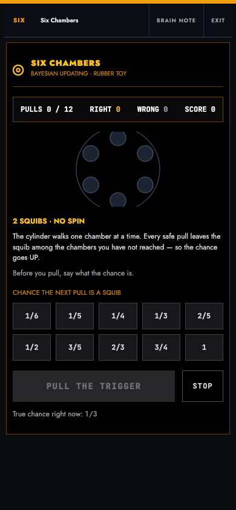
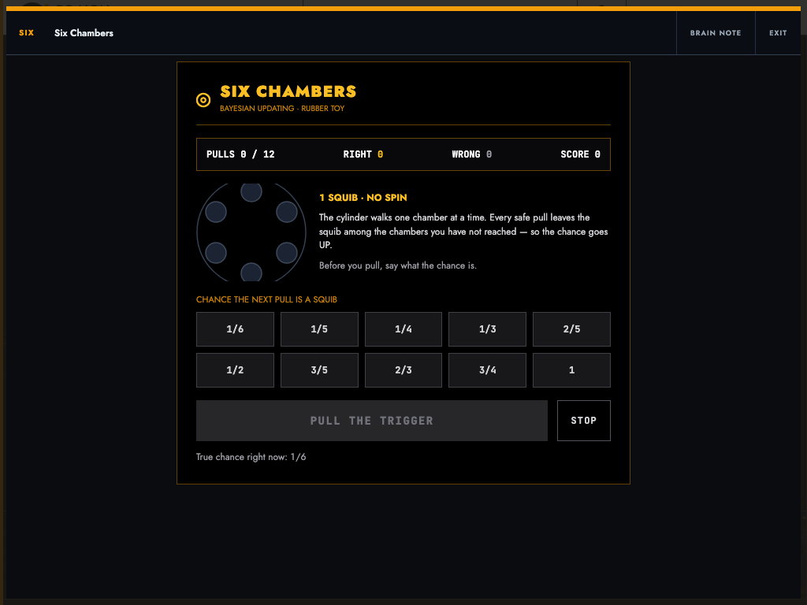
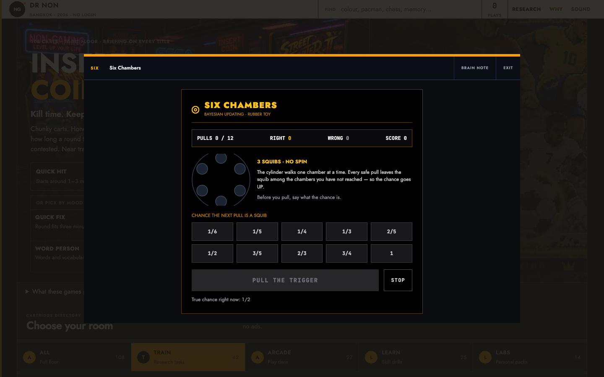
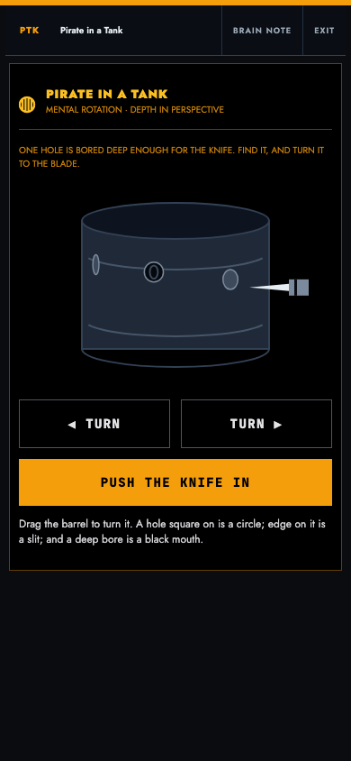
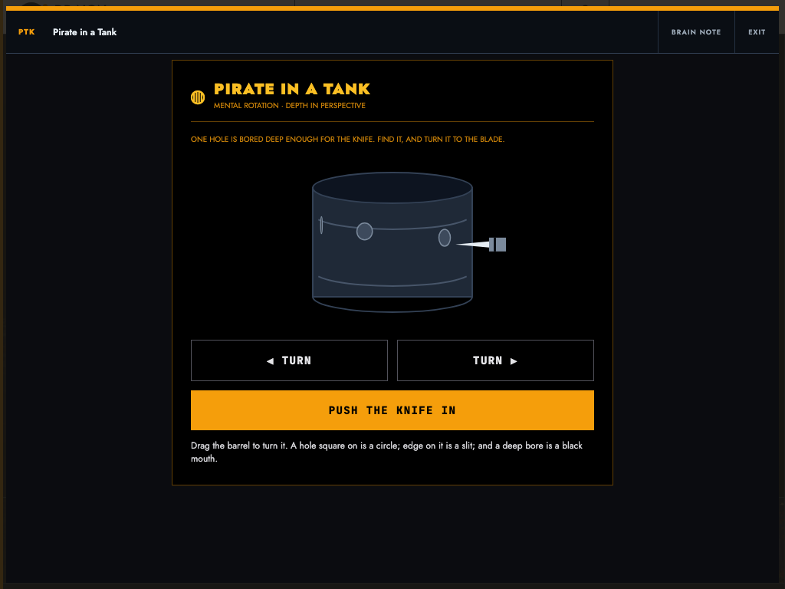
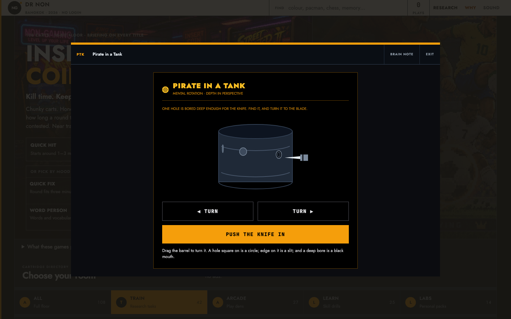

# MSH record — Six Chambers and Pirate in a Tank

Date: 2026-11-06
Commit: `e8bdf5c` (deployed, `local == remote == live`)
Live: https://games-bm7.pages.dev/ · custom domain https://games.nonarkara.org/

Two new cartridges, both built to the house conventions and both carried
through every keyed registry. This is the measured record, not an opinion.

---

## Found

Measured on the real interface at 390, 1024 and 1440 px.

| What | Where | Cost to the player |
|---|---|---|
| `holeAtKnife()` compared the angle wrongly and returned the hole on the **far side** of the barrel | `js/games/pirate-tank.js` | The knife could never reach the deep bore. The game looked right and was unwinnable. |
| The probability chips offered **impossible** answers — "2 in 1" and "0" | `js/games/six-chambers.js` | A player could state "2/1" and be marked right. The board had to be read before it could be trusted. |
| The open chambers were **inferred from a pull count**, not recorded | `js/games/six-chambers.js` | Spun, the cylinder lands on a random chamber, so the renderer showed chambers the player had never touched as opened and hid the ones they had. |
| The cylinder was drawn near-black on a black frame | `js/games/six-chambers.js` | The centrepiece of the game was effectively invisible. |
| The barrel was drawn as two overlapping discs | `js/games/pirate-tank.js` | It did not read as a barrel. It read as a UFO. |
| The knife sat on a fixed line while the holes sat at different heights | `js/games/pirate-tank.js` | The blade pointed at empty wood while the game said the bore was at the blade. |
| The smoke harness clicked the wing tab without waiting for it | `scripts/browser-smoke.mjs` | Intermittent `TypeError: Cannot read properties of null (reading 'click')` — see *The race* below. |

## Changed

- **Geometry rebuilt.** `holeFacing()` and `angleDelta()` are exported, and
  `holeAtKnife()` now finds the hole that actually faces the blade. The
  knife tracks that hole's height, so the blade meets the mouth on screen.
- **Chips are real probabilities only.** Exactly ten: `1/6 1/5 1/4 1/3 2/5
  1/2 3/5 2/3 3/4 1`. Ten chips in five columns leaves no stranded cell.
- **Open chambers are recorded**, per chamber, not counted.
- **Cylinder contrast raised**: an unvisited chamber is a lit disc, a
  visited one a hole, the squib amber. None of the three is near-black.
- **Barrel redrawn** as a standing tube — top opening, two hoops, bottom
  rim — with the deep bore drawn as a black mouth you look down, and the
  shallow holes as dim grey ones.
- **The harness polls every control** before clicking it, and waits for the
  app to paint its floor rather than for the document's load event.

## Verified

| Check | Result |
|---|---|
| `npm test` | exit 0 — 19 suites, 109 cartridges, 0 orphans, 0 gaps |
| `npm run check` | exit 0 — every utility used has a rule |
| `scripts/visual-audit.sh` | 0 violations, 16-bit register clean |
| `scripts/geometry-audit.mjs` | no violations at 390 / 1024 / 1440 |
| `npm run smoke` (localhost) | 108/108 carts |
| `npm run smoke` (live alias) | 108/108 carts at `e8bdf5c` |
| `scripts/verify-live.sh` | local == remote == live |

Measured on the two new surfaces, live:

| | 390 | 1024 | 1440 |
|---|---|---|---|
| Six Chambers frame | 370 × 649 | 576 × 537 | 576 × 537 |
| Pirate in a Tank frame | 370 × 563 | 576 × 555 | 576 × 555 |
| Horizontal overflow (both) | 0 | 0 | 0 |
| Document overflow (both) | 0 | 0 | 0 |
| Smallest control | 44 px | 44 px | 44 px |
| Probability chips | 10, in 2 rows of 5 | same | same |

Chrome cost is unchanged: the header is 45 px and the chrome band is
5.0–5.3 % of the viewport. Worst measured page contrast is 4.77:1 on
tablet and desktop, 5.38:1 on phone — both above the §11.10 floor.

### The race

The live smoke had failed once at cart 50 (`slide-2048`) with
`TypeError: Cannot read properties of null (reading 'click')`. The failing
column was fingerprinted against candidate expressions instead of guessed
at: a null click on `document.querySelector('[data-wing="all"]').click()`
reports column **43**, while the slide-2048 cart click reports column
**61**. The recorded failure was `at 58:1:43` — so the wing-tab click, and
slide-2048 was innocent.

The cause: the harness waited for the document and then clicked the wing
tab, but the floor is painted when the app's module runs, which on a live
deployment is later than the load event. Reproduced deterministically by
holding `app.js` for five seconds — at the harness's click point the tab
was absent (`tabPresent: false`, `rows: 0`), the old expression threw the
exact recorded error, and the polled one waited 1512 ms and succeeded.

### Mutation-proofing

Every guard was broken on purpose and required to go red:

- Six Chambers: 7 mutations — probability stops climbing, spun probability
  climbs, impossible chips admitted, fraction equality instead of
  cross-multiplication, score allowed below zero, cylinder picks a random
  chamber, open-chamber tracking removed. **7/7 detected.**
- Pirate in a Tank: 10 mutations — including the original bug reproduced
  exactly (the angle complemented, so the far-side hole is returned), the
  90° offset dropped, the tolerance widened, `insert()` ignoring which
  bore is at the blade, `closeness()` always reporting 1, `turn()` not
  wrapping, and two deep bores instead of one. **10/10 detected.**

## Remaining

- The deep bore is only unmistakably black when it faces you. Edge on, it
  is a thin slit, and the player has to catch it wide and then remember it
  while the barrel turns. That is the intended rotation load, but it is
  the sharpest edge in either game.
- The custom domain `games.nonarkara.org` carries a 4 h stale-asset risk
  from the Cloudflare zone. The versioned alias is the honest audit target
  and is what every number above was measured on.
- `js/daily.js` no longer names a cartridge count at all. It reads
  "a hundred-odd cartridges". The count-claims guard still passes, but the
  honest fix is to let the number be computed rather than written down.

---

## Captures

Taken from the deployed site, `https://games-bm7.pages.dev/?game=<id>`.

| 390 px | 1024 px | 1440 px |
|---|---|---|
|  |  |  |
|  |  |  |
